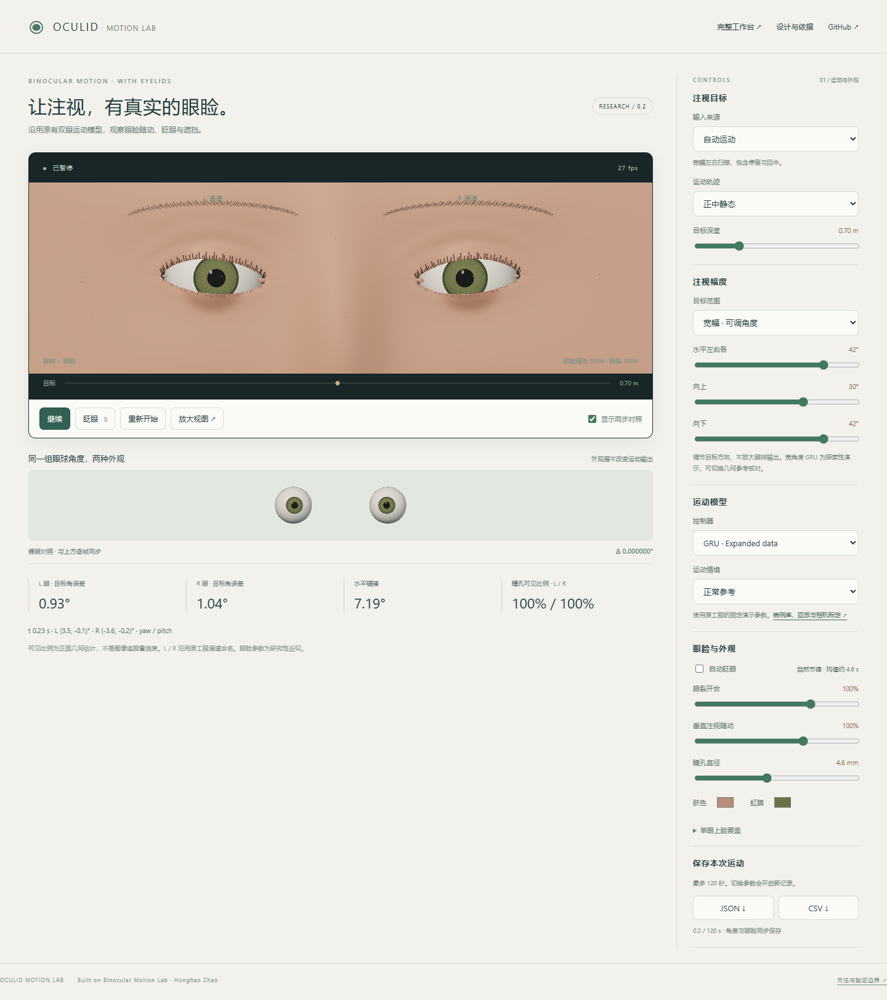

# Oculid Motion Lab

**A binocular motion simulator with animated eyelids, built on Binocular Motion Lab.**

[Live demo](https://zhh0907.github.io/oculid-motion-lab/) · [Complete workspace](https://zhh0907.github.io/oculid-motion-lab/workspace.html) · [中文调研与设计](docs/RESEARCH.zh-CN.md) · [Architecture](docs/ARCHITECTURE.md)



## 0.2 更新

- 眼睑随动加入时间响应：上看、下看速度不同；眼球立即沿原模型运动，眼睑随后跟进。
- 眨眼使用快闭慢开曲线和可重复的非等间隔节律，加入鼻侧组织滑动、下睑抬升、褶皱展开及睫毛弯曲。眉毛不会跟着每次眨眼整体下移。
- 重建眼周与鼻梁连接，消除径向网格造成的圆形接缝和眼角尖锐褶皱；加入湿润睑缘、细微肤色变化和简化角膜反光。
- 首页默认目标范围扩大到水平 **左右各 42° / 上 30° / 下 42°**。支持独立调整，以及一键切回原版范围。这里只修改目标方向，病例参数、GRU 和食指投影没有增益放大。
- [本次设计依据与验证](docs/REALISM-v2.zh-CN.md)。宽幅 GRU 行为仍属探索，范围预设不是统一的人体生理限位。

## 已实现

- 连续三维上下眼睑、垂直注视随动、自动/手动眨眼、单眼上睑覆盖、可调眼裂。
- 程序化虹膜、可调瞳孔、简化角膜高光、眼周皮肤、睫毛及眉毛。
- 原有两种 GRU、几何参考、正常及三种固定受限运动情境。
- 自动水平/垂直/圆周/阶跃/远近目标、鼠标/触控和本地摄像头食指跟随。
- 新旧外观共享相同角度，支持逐帧同步对照；最多 120 秒 JSON/CSV 数据导出。
- 完整工作台保留原工程的病例库、数据回放、移动端工具栏、屏幕/相机标定与历史导出格式。

This is a procedural research prototype. It adds anatomical appearance and eyelid occlusion while preserving the existing gaze controller. It is not a scan-quality human face, an optical ray tracer, a validated eyelid physiology model, or a new image-based gaze tracker.

## Compatibility evidence

| Check | Result |
| --- | --- |
| Upstream-generated golden fixture | **3,600 samples, exact angle equality** across 2 GRUs + ideal geometry and 4 patterns |
| Node tests | **27 passed**, including upstream patient/demo tests, lid closure/bounds, invariance and audited file hashes |
| Homepage browser tests | Rendered iris, exact same-pose comparison, full closure, cases, pointer/camera boundary, tracking loss/recovery, JSON/CSV, reduced motion |
| Complete workspace and demo | Patient persistence/import/export, all replay controllers, seeking, injected live input and mobile tools passed |
| Layout | 1440 px desktop and 320/390/844 px mobile viewports checked |
| Physical-camera accuracy | **Not measured**; camera integration tests inject targets at the existing input boundary |

See [validation details](docs/VALIDATION.md). Eyelids never feed back into the controller. This gives software compatibility for the same inputs and state, not a guarantee that an external eye tracker can recover gaze through occluded pupils. Fully closed eyelids contain no visible pupil information.

## Run locally

```sh
python -m http.server 8000 --bind 127.0.0.1
```

Open `http://localhost:8000/`. No npm build, API key, runtime CDN, or backend is required. Keep `vendor/`, `recordings/` and all model JSON files in place. Camera access needs localhost or HTTPS.

The homepage is the new Chinese control surface. `workspace.html` provides the inherited English research workspace; `demo.html` provides the three fixed cases with eyelids. Changing homepage options begins a new recording. The manual blink button or **B** key starts a blink; pause stops simulation time. Disabling comparison hides only its view.

The homepage uses the original assumed-plane camera mapping. Use the complete workspace when measured camera/screen calibration or human-data replay is needed. Patient and calibration storage have independent Oculid keys, so this project does not overwrite the original site's saved settings. Transfer them explicitly via JSON export/import.

## Tests

```sh
npm test
npm ci
# Browser tests require Google Chrome; all processing stays local.
npm run test:browser
npm run test:workspace
```

Node 22+ is recommended. Browser tests use Playwright; the homepage test can select an installed channel through `PW_CHANNEL`. Generated screenshots/downloads are ignored under `qa/`; the checked-in preview and compact report are under `docs/`.

## Layout

| Path | Purpose |
| --- | --- |
| `src/simulation.mjs` | Target and controller orchestration, synchronized export |
| `src/eyelid-model.mjs` | Pure deterministic eyelid/blink/visibility math |
| `src/target-range.mjs` | Angular target excursions; original camera mapping is unchanged |
| `src/periocular-shape.mjs` | Continuous eyelid/contact and face surfaces |
| `src/eye-rig.mjs` | Eye, lid and eye-region meshes and materials |
| `src/main.mjs`, `index.html`, `oculid.css` | New interface |
| `workspace.html`, `app.js` | Complete inherited workspace with new eye meshes |
| `engine.js`, `models-selected.json`, `patient-model.mjs` | Audited upstream motion code and weights |
| `docs/upstream-manifest.json` | Original commit, file hashes and storage-only adaptations |
| `tests/fixtures/upstream-golden.json` | Independent outputs generated from the original project |

## Research and attribution

The [research review](docs/RESEARCH.zh-CN.md) compares SynthesEyes, UnityEyes, UnityEyes 2, U2Eyes, RIT-Eyes, Temporal RIT-Eyes, OpenEyeSim, PyEtSimul, AniEyelid and Pupilla. It is a focused public-source review dated 2026-10-27, not a claim to have exhaustively tested every simulator online. Their research assets are not bundled here.

Built from Honghao Zhao's [Binocular Motion Lab](https://github.com/zhh0907/binocular-motion-lab), including its current local three-case demo. The original checkout was not edited. Existing Three.js, MediaPipe and GazeBaseVR attributions remain in [THIRD_PARTY_NOTICES.txt](THIRD_PARTY_NOTICES.txt). New Oculid source files use the scoped [MIT license](LICENSE); inherited assets retain their existing terms.

No new human-eye training, physiological validation, or medical grading was performed. GazeBaseVR model metrics do not establish the accuracy of the added eyelids or a camera system. Future high-fidelity eye-region assets can replace the renderer while retaining the same motion contract.
