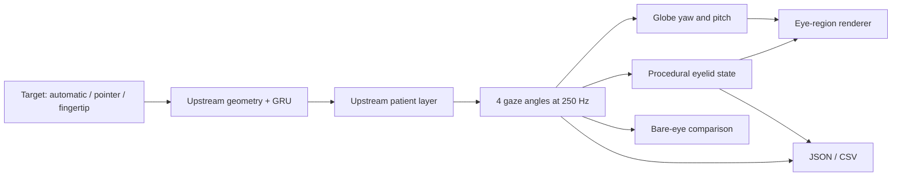

# Oculid architecture and reproducibility

`src/simulation.mjs` orchestrates unchanged upstream inference and patient functions. `src/eyelid-model.mjs` contains deterministic appearance math without DOM or Three.js. `src/eye-rig.mjs` owns geometry and materials. `src/main.mjs` connects controls, camera lifecycle, playback and downloads. The original UI remains at `workspace.html`; `app.js` changes its rendered eye construction, not motion calculations. `demo.html` uses the same new renderer for its three fixed cases.

Distances are metres, time is seconds, angles are degrees. Coordinates and L/R array order stay compatible with upstream: +Z forward, yaw about Y, pitch about local negative X; no torsion. Do not infer anatomical left/right from screen position. Front-facing render and camera preview mirroring are separate conventions. Eye separation is 64 mm for generated targets, and replay uses the original recording centres.

Eyelid shape uses an almond profile across fixed corners. The upper and lower apex depend on openness and pitch; a blink moves both to one common seam. The contact surface clears the original spherical globe and simplified corneal cap. The face mesh contains holes behind the eyelid regions. The iris mesh uses front-facing triangles and a polar shader, with pupil diameter independent of gaze. No inverse eye tracking occurs in the renderer.

## State and export

Motion options and appearance edits reset the homepage's current run. Appearance is therefore constant within an exported run, except for time-dependent blinking and separately recorded manual blink times. Pausing holds simulation time and lid state. A missing fingertip holds all state and adds no observations. Reacquisition clears recurrent controller history, as in upstream, while preserving the patient plant state. The 250 Hz grid is model time, not a hardware frame-rate guarantee. Large wall-clock gaps are capped; hidden-tab playback is not real-time acquisition.

`oculid-run-v1` includes model ID, patient parameters, coordinate declaration, appearance, input settings, manual blink timestamps, and up to 30,000 samples (120 seconds). Each sample includes target, ideal/reference/output angles and each lid's apex/closure/pupil visibility. It is valid to export hidden gaze angles when the pupil is fully occluded, but those values are simulation ground truth rather than observations. Files stay in browser memory until downloaded.

The homepage camera uses an assumed plane and the original FOV/chest-camera defaults. Physical calibration and dataset replay remain in the complete workspace. The workspace retains `gaze-patient-run-v1` and the original CSV columns, with procedural lid animation in the view only. Homepage/manual-blink data are not silently inserted into legacy exports.

The original GitHub Pages origin can host multiple projects. Oculid uses `oculid-motion-patients-v1` and `oculid-screen-calibration-v1` storage keys. No automatic migration or edits to the original site's browser storage occur. Export/import is the explicit transfer path.

## Verification

Run `npm test` (no installation needed for the Node tests). Run `npm ci`, install Chrome if needed, then `npm run test:browser` and `npm run test:workspace`. All browser tests use Playwright and write screenshots/reports to local output folders. Test-only target injection does not assert physical camera quality.

`docs/upstream-manifest.json` audits unchanged code/weights and the two storage-only adaptations. `tests/fixtures/upstream-golden.json` was generated by importing modules from the original repository, not Oculid. It holds 300 targets each for two GRUs plus ideal geometry, crossed with four case patterns (3,600 outputs). Tests compare every output angle exactly. These checks verify software compatibility, not biological accuracy.

The repository has no runtime build step or CDN dependency. Serve its root over HTTP or HTTPS; `file://` cannot load modules or models correctly. Runtime assets retain their upstream notices and data attribution.
