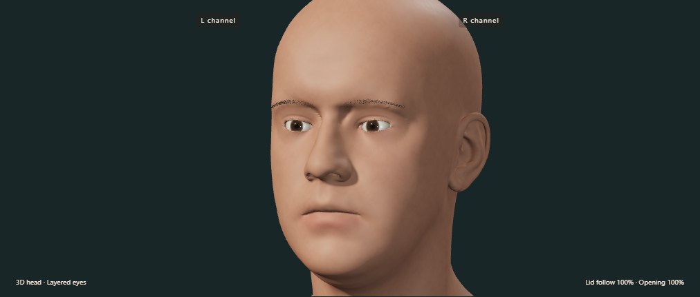
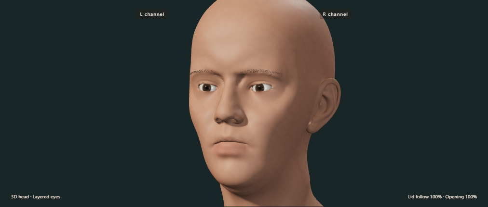

# Face shapes and English interface — v0.8

Use **Face & eyelids → Face shape → Male / Female** on the homepage. The full workspace and three-case demo have the same selector. Skin tone is an independent setting. Both shapes retain animated 3D eyes and eyelids, and can be inspected in clay or wireframe mode on the homepage.

The two presets are authored variants of the existing Lee Perry-Smith base scan. The female preset is a geometric adaptation, not a separate scanned person or a population-based anatomical model. The base geometry and its derivatives retain the CC BY 3.0 attribution in `THIRD_PARTY_NOTICES.txt`.

## Geometry

`face-profiles.mjs` combines smooth spatial fields to adjust jaw width, chin contour and height, nasal projection, cheeks, lips, brow and forehead. Eye openings and nearby contact tissue are protected by a field whose displacement is exactly zero. The renderer precomputes the resulting per-vertex displacement `ΔP` once:

`P_display(t) = P_canonical(t) + w × ΔP`, where `w = 0` for Male and `w = 1` for Female.

`P_canonical(t)` is the original connected head with the current eyelid pose. Every update starts from this canonical mesh; toggling does not successively deform an already modified face. Shared boundary indices remain shared in either preset. The apertures, eyeballs and motion controller are unchanged. Hair roots remain attached to the underlying skin triangles.

The amounts are artistic engineering choices. They do not define universal male/female anatomy and are not additional patient or disease parameters.

## State and export

Changing the homepage face shape does not reset the run, resample a patient, clear traces, advance paused time or alter any eye angle. JSON adds `faceProfileVersion: "head-shapes-v1"` and `faceChanges`, an ordered list of `{time, faceType}` entries. The first entry records the initial shape at time zero; later timestamps use the next simulation sample time. Multiple changes while time is held are coalesced into the final choice at that time.

`appearance.faceType` contains the current choice. To reconstruct earlier appearance, use the timeline and select the last entry whose time is no later than the sample time. Restarting the run clears the timeline and uses the current shape as its initial entry. CSV contains motion, not face appearance. The inherited workspace/demo keep their existing motion export formats.

## Checks

The pure geometry test verifies substantial jaw/nose changes and exact preservation of the eye-opening zone. A simulation comparison switches shapes during 600 arbitrary 3D targets and compares complete gaze/lid samples against a run without shape changes. Browser checks exercise the actual selector, verify exact vertex restoration, preserve a selected patient's dynamic state and recording history, check the JSON timeline, and render female side views, wide gaze and closure. English controls and mobile layouts are also checked.

These checks establish implementation behaviour, not clinical validity or photorealism.
