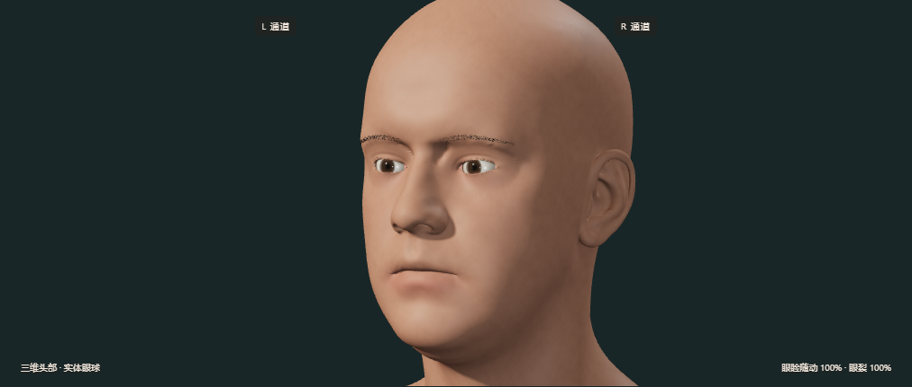
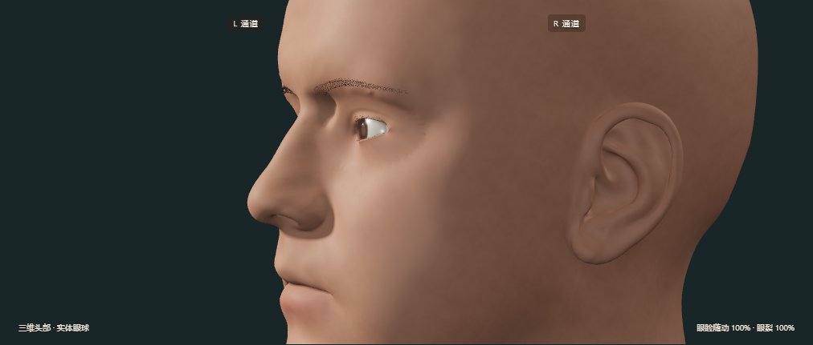
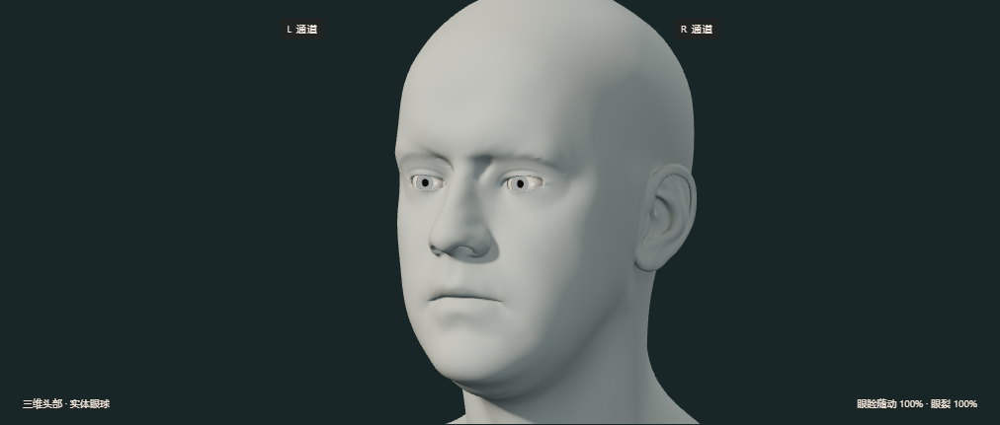

# 0.7：连接头部与眼睛的三维模型

这一版将头部、动态眼睑和分层眼球放入同一个可旋转场景。运行时不加载整张人脸照片，也不再使用上一版由正面采样得到的眼周深度片。脸部的鼻梁、面颊、耳朵和后脑来自开放许可扫描网格，眼窝重新开口并与动态眼睑缝合。

## 操作

- 默认可以拖动画面旋转头部，用滚轮缩放。画面获得焦点后也支持方向键和 `+ / -`。
- “灰模”去掉肤色、毛发和透明角膜，方便查看几何形状；“网格”显示三角形及眼内结构。
- “正面检查”恢复正面近景，并关闭拖动旋转。选择鼠标/触控跟随也会自动关闭旋转，避免同一手势同时转动相机和移动目标。
- 摄像头食指、自动目标、固定患者、眼位滑轴、时间曲线及二维轨迹继续使用原来的运动模型。相机和显示模式不会重置患者或仿真时钟。
- 肤色仍为五种常见预设；虹膜为三种预设。

## 几何如何连接

`head-topology.mjs` 读取扫描的三维顶点和三角形，焊接重复顶点并做一次 Loop 细分。每个眼窝移除内部三角形后，提取真实的边界边，细分过长边，并将 18 圈动态眼睑接到边界上。左右眼分别有 196、184 个共享边界顶点。外圈不是两个重叠的面：头部和眼睑直接使用同一组顶点编号，每条接缝边恰有两个相邻三角形。

初始眼睑在固定内外边界之间平滑；连接两侧的网格再做局部平滑，降低扫描切口的折痕。运动时采用

`P(q, θ, t) = P_rest(q, θ) + (1 − q)² × [E(θ, t) − E_rest(θ)]`

其中 `q = 0` 是睑缘，`q = 1` 是与头部共享的边界，`E` 是原眼睑状态模型计算的睑缘。所以睑缘随眨眼和注视运动，外圈位移严格为零。睑缘向后连接 0.85 mm 的内壁；上睑增加小幅几何折痕，并限制组织表面位于当前眼球/角膜外侧。眉毛和睫毛使用细管网格，眉毛根部以重心坐标绑定到皮肤三角形。

这是可实时变形的表面模型，不是有限元组织力学。局部平滑、厚度和折痕幅值是外观工程参数；并未用患者扫描或组织力学数据拟合。

## 眼球不是一个画着瞳孔的球

- 巩膜网格的前端有真实开口。
- 虹膜位于眼球中心前方 10.55 mm，半径 5.7 mm，是带轻微起伏的环形网格。
- 瞳孔是虹膜中央的真实孔洞，后方为深色眼内腔；调节瞳孔会改变孔洞大小。
- 角膜为独立凸面，球面半径 7.8 mm、球心前移 5.6 mm，透明材质产生随观察角度变化的反射与透射。使用 Three.js 的近似材质，不是经验证的眼科光线追迹器。
- 虹膜纹理、微小皮肤起伏和粗糙度均在程序中生成。皮肤细节绕头部包裹，避免正面投影在侧脸被拉成长条。

这些尺寸用于当前模型的层次与接触关系，不能当作已经验证的个体解剖参数。眼球转动仍直接读取原来的四个角度，显示相机从外侧绕模型旋转。

## 眼位数据的含义

角度数据和病例模型不变。滑轴现使用实际虹膜平面深度：

`u = 0.01055 × sin(yaw) × cos(pitch) / 0.0132`

它是固定正面参考坐标中的几何瞳孔中心，不会因用户旋转相机而改变。它不包含透视、角膜折射，也不是从当前截图重新追踪出来的眼位。瞳孔可见比例同样是正面参考估计，不能用来解释大侧角截图中的可见程度。

## 验证与范围

38 项 Node 测试通过，包括 3,600 个原始运动输出逐值相等、眼睑连接拓扑和眼球接触检查。首页、患者库、完整工作台、三病例 demo 和新增三维外观浏览器检查通过。新增检查涵盖真实拖动旋转、正面复位、灰模/网格切换、接缝坐标在运动中固定、完全闭眼、五种肤色、患者状态保持、无照片贴图请求，以及 320/390 px 布局。

人工查看了正面、约 63° 侧面、灰模、网格、上下左右注视和闭眼截图。[外观检查报告](face-report.json)。本机 Chrome 无头浏览器在 1440 × 1100 页面下测得 180 帧的中位间隔约 22.2 ms；这不是手机或其他显卡的性能保证。

它已是可交互的三维模型，但皮肤光学、表情、毛发及个体差异仍属简化实现，尚未达到真人数字替身的视觉质量。临床合理性和 NIHSS 评分仍需医生评阅，系统不自动给合成患者贴分数。

## 素材署名

基础头部网格：Lee Perry-Smith 的 *Infinite, 3D Head Scan*，基于 Triplegangers 的作品，采用 [CC BY 3.0](https://creativecommons.org/licenses/by/3.0/)。来源为 [Three.js r180](https://github.com/mrdoob/three.js/tree/r180/examples/models/gltf/LeePerrySmith)，原许可和校验值保存在 `vendor/face/`。本版对网格做了缩放、对齐、细分、眼窝切口和动态眼睑连接。原始颜色图片仅保留作历史素材溯源，运行时不读取它。扫描人物不代表任何实际疾病或合成病例。
